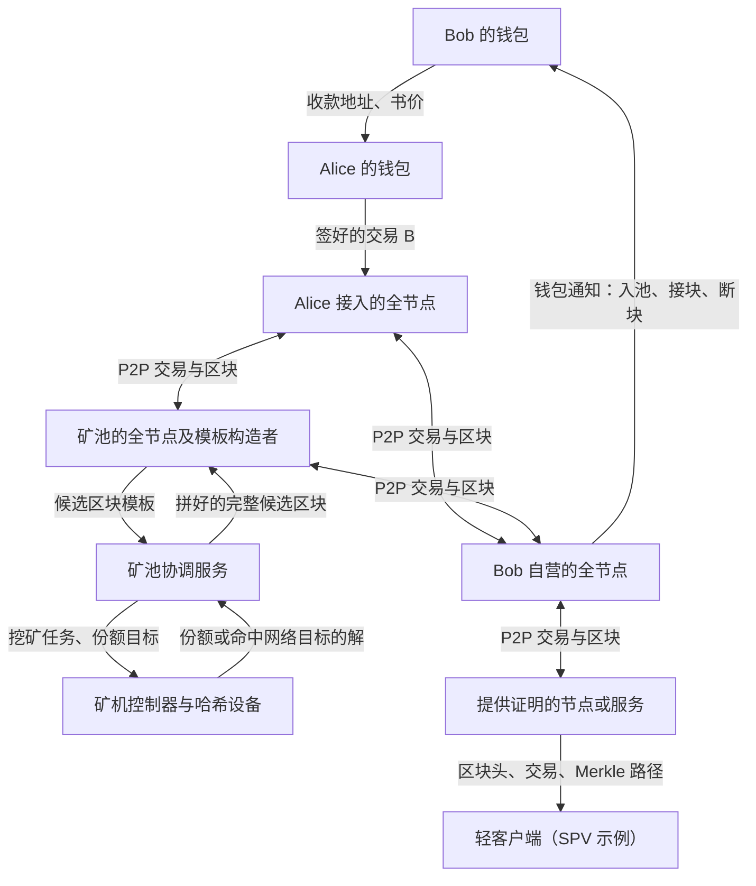
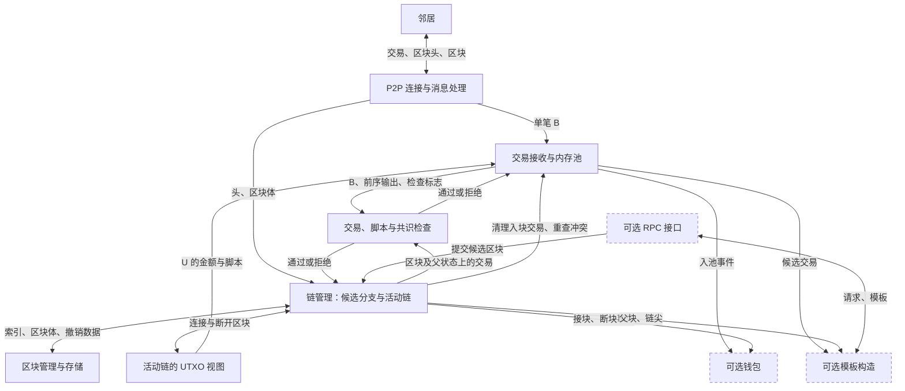

# 一笔 BTC 付款的一生

[打开七步交互图解（HTML，可离线浏览）](btc-payment.html)

[七步源码导读：Bitcoin Core、btcd 与 btcwallet](BTC交易源码导读.md)

Alice 向 Bob 买一本书，价格是 60,000 聪（sat，1 BTC 等于一亿聪）。Alice 点击发送，Bob 的钱包很快显示「收到 60,000 聪，0 次确认」。如果 Bob 这时把书交出去，他已经知道什么？还在承担什么风险？

我们沿用一笔离线教学交易 **B**，假设 Bob 用自己的全节点观察。全节点是自己下载并检查交易和区块的程序。全程跟踪两样东西：网络中传递的消息，以及 Bob 的节点根据当前采用的区块历史算出的可花资金。它们在不同的时刻发生变化。

## 1. Bob 给出地址，约定以后谁能花这笔钱

Bob 的钱包给 Alice 一个收款地址，并告诉她价格。这个例子用 P2WPKH，即一种按公钥哈希收款的方式。Bob 保存私钥，用它签名；别人用对应的公钥检查签名。哈希是从数据算出的固定长度摘要。Alice 的钱包从地址解出 Bob 的公钥哈希，把它写成一个花费条件：未来花这笔输出时，须提供匹配的公钥和有效签名。

这一步解决「钱要锁给谁」。地址校验和能发现许多抄写错误，但如果有人把整个二维码换成自己的有效地址，校验仍能通过。Alice 要核对收款地址和金额。此时还没有交易上链。

**技术展开 · 从密钥到脚本。** 本例选用原生隔离见证的单公钥哈希付款，简称 P2WPKH。Bob 的钱包取一个私钥标量 `d`，用 secp256k1 曲线上的标量乘法算公钥点 `Q = dG`，其中 G 是公开约定的基点。随后把 Q 编码成 33 字节的压缩公钥，计算 `HASH160(pubkey) = RIPEMD160(SHA256(pubkey))`。钱包把主网前缀、见证版本 0 和这 20 字节的结果用 Bech32 编成带校验和的地址。Alice 解码并检查网络、版本、长度和校验和，得到要写进输出的脚本。[BIP173 地址编码](https://bips.dev/173/) · [BIP141 见证程序](https://bips.dev/141/)

本例的脚本是 `00 14 06afd46bcdfd22ef94ac122aa11f241244a37ecc`。按字节读，`00` 表示版本 0，`14` 是十六进制的 20，后面正好是 20 字节哈希。**Bob 收钱时不用签名**；将来他花这项输出时，节点才要求他出示匹配的公钥和签名。接下来 B 里出现的签名属于 Alice，因为此刻被花掉的是 Alice 的旧输出。

## 2. Alice 选出一笔旧款，写明它将变成什么

Alice 以前收到过一项价值 100,000 聪的输出，叫 **U**。它在当前历史上还没被花掉，称为**未花费交易输出（UTXO）**。钱包把自己能花的输出加起来，才得到界面上的余额。B 的输入用「前序交易标识＋输出编号」点名 U，节点据此查到金额和原有花费条件。U 须一次用完，所以 Alice 为自己写一个找零输出。

| B 如何使用 U | 金额 | 今后谁能花 |
|---|---:|---|
| 输出 0，支付书款 | 60,000 聪 | Bob，凭匹配的密钥 |
| 输出 1，找零 | 39,000 聪 | Alice，凭找零密钥 |
| 输入减去全部输出的差额 | 1,000 聪 | 计为手续费，可由出块矿工领取 |

这一步解决「花哪笔钱，钱去了哪里」。任何验证者都能复算 100,000 − 60,000 − 39,000 = 1,000。若 Alice 漏写找零却照常签名，差额就成了 40,000 聪手续费；协议能检查金额规则，只有钱包和付款人知道原本的意图。[交易与输出](https://developer.bitcoin.org/devguide/transactions.html)

**技术展开 · 选币、估费与序列化。** 钱包先列出自己能控制且可用的 UTXO，每项都有唯一引用 `(前序 txid, 输出编号)`、金额和脚本。选币要同时覆盖付款与预估手续费；增加输入或找零输出也会增加交易大小。多个候选可用时，一种算法是分支限界搜索（Branch and Bound）：逐项尝试选或不选，当剩余候选已无法凑够目标时停止搜索该分支。它可以用来寻找适合免找零的组合；钱包也可采用其他选择策略。本例只有一项合适的 U，直接选它并找零。[Bitcoin Core 选币说明](https://bitcoincore.academy/coin-selection.html)

B 写入版本 2、一个引用 U 的输入、两个输出和锁定时间 0；输入采用最终序号 `ffffffff`，原生见证输入的 `scriptSig` 为空。U 的金额来自前序输出，输入引用本身只写交易标识和编号。Bob 的新输出按顺序写成 `60 ea 00 00 00 00 00 00 | 16 | 00 14 …`：前八字节以小端序编码 60,000 聪，`16` 表示后随 22 字节脚本。**手续费和“这是找零”都没有独立字段**；前者靠减法，后者是钱包知道的归属。[交易字段参考](https://developer.bitcoin.org/reference/transactions.html)

## 3. Alice 签名，授权这一次花费

钱包用控制 U 的私钥，给 B 的签名摘要签名。本例采用 SIGHASH_ALL，摘要绑定 U 的引用、金额以及两个新输出等数据。钱包把签名和公钥放进交易的「见证」，供节点检查。Alice 的私钥留在钱包里。如果旁人把 Bob 的金额从 60,000 改成 61,000，节点按新内容验签，原签名就会失败。[BIP143 签名摘要](https://bips.dev/143/)

现在引入贯穿全课的冲突。Alice 自己完全可以再签一笔 **C**，也引用 U，却把钱付回自己。两份签名都可能正确，因为两份都是她签的。**签名回答了「持钥人授权了什么」，还需要一段共同认可的历史来判断「哪一次花费生效」。**

**技术展开 · 到底签哪些字节？** 对这个输入采用 BIP143 的普通 `SIGHASH_ALL`。令 H 表示连续两次 SHA-256；钱包先分别计算全部输入引用、全部输入序号和全部新输出的 H，然后依次编码以下字段，再对整体做 H，得到签名摘要 z。签名摘要、交易标识和区块哈希分别对不同的数据计算。[BIP143 字段与测试向量](https://bips.dev/143/)

```text
版本 | 全部输入引用的哈希 | 全部输入序号的哈希
     | 当前输入引用 U | U 对应的 scriptCode | U 的金额 100,000 | 当前输入序号
     | 全部输出的哈希 | 锁定时间 | 签名模式
```

这里的 scriptCode 是按 Alice 的公钥哈希构造的传统公钥哈希检查脚本。ECDSA 签名时取保密的一次性标量 k，计算 R = kG，取其横坐标对曲线基点的阶 n 求余得到 r，再算 s = k⁻¹(z + r·d) mod n（此处 d 是 Alice 的私钥）。有效的 (r,s) 编码为签名，附上表示签名模式的字节；输入见证里放这份签名和 Alice 的公钥。

验签方先用 U 核对公钥哈希，并独立重算 z。检查 r、s 的范围后，求点 (z/s)G + (r/s)Q（标量运算模 n），检查它的横坐标模 n 是否等于 r。因为 Q = dG，这个点在有效签名下重现签名者的 R 的横坐标关系。把 Bob 金额改掉会改变输出哈希和 z；Alice 主动为 C 再签一次则会得到另一份可验证的授权。可继续展开的问题是：如果两个不同摘要重用了同一个 k，为什么两条签名方程会暴露私钥？

## 4. 节点传播、检查、入池，Bob 看见 0 次确认

Alice 的钱包把 B 发给一个节点。节点可先向邻居通告交易标识，需要数据的邻居再索取完整交易。每个接收节点自己检查：交易能否解析，输入是否可用，签名是否满足 U 的条件，输出是否超过输入，是否与已知花费冲突。节点还按本地策略决定是否收下和转发，例如考虑单位空间的手续费。B 占用 141 虚拟字节，费率约为 1,000 ÷ 141 = 7.09 聪／虚拟字节。

通过检查后，B 可以进入该节点的**内存池**，即它保存的未确认交易集合。Bob 此时看见付款意图，也能检查签名。另一个节点可能先看见 C，或者因费率门槛而没有收下 B。传播解决消息可达的问题，各节点的内存池可以不同。**Bob 的已确认账本此时仍有 U，还没有 B 的输出 0。**

**技术展开 · 消息、验证和池状态。** 一次典型中继是 `inv → getdata → tx`：邻居先通告标识，接收方缺数据才请求，发送方再给完整字节。B 的 txid 对去掉见证的交易编码做双 SHA-256；wtxid 对带见证的完整编码做同样计算。支持相应协商的节点可以按 wtxid 通告；后续花费引用输出时仍使用 txid。[BIP339 按 wtxid 中继](https://bips.dev/339/)

节点需要回答三类问题。① 数据自身是否成立？输入输出要有内容、金额在范围内、输入引用不能重复；否则把 U 写两遍就可能虚报拥有 200,000 聪。② 对当前视图能否执行？从链状态及可用未确认父交易中找输入，核对成熟度和时间锁，在各输入的前序输出上验签，并核算输入总额至少覆盖输出。③ 本节点是否愿意接受和转发？比较池内冲突、费用和资源限制。本例基础编码为 113 字节，完整编码为 223 字节，权重为 3 × 113 + 223 = 562，虚拟大小为 ⌈562/4⌉ = 141 vB。若本节点的费率门槛高于 7.09 聪/vB，B 可能进不了它的池。通过时只记录池内 B 对 U 的占用；链上的 U 仍然存在。[BIP141 权重](https://bips.dev/141/) · [Bitcoin Core v29.0 验证实现](https://github.com/bitcoin/bitcoin/blob/v29.0/src/validation.cpp)

## 5. 矿工选交易、组块，为一种历史顺序提供工作量

矿工以一个已知区块为父块，挑选能一起执行的交易组成候选区块。容量有限，矿工通常会考虑费率和交易依赖。若选了 B，就不能在同一块里再花一次 U。矿工还放入一笔特殊的奖励交易，可领取区块补贴和所收录交易的手续费。B 即使已经入池，也可能要再等几块。

矿工把有序交易的标识逐层配对求哈希，得到一个摘要（Merkle 根），写进区块头；区块头也引用父块的哈希。本例的见证数据另由奖励交易中的承诺绑定。矿工反复改变候选数据，直到区块头的哈希值不超过规定目标，这叫**工作量证明（PoW）**。别人很容易复核这次结果。链接父块、绑定交易并要求工作量，使改写旧付款的人必须为修改后的块及后续历史重新竞争。矿工此时得到一个可广播的块，每个全节点仍须自行验块。[区块与工作量证明](https://developer.bitcoin.org/devguide/block_chain.html)

**技术展开 · 候选集合 → 两类承诺 → 工作量证明。** 矿工先在区块重量等限制内选取交易。若子交易花了尚未确认的父交易输出，想收进子交易就得把父交易放在前面，并可一起评估两者的费用。奖励交易 coinbase 放在首位，允许领取的上限是该高度的补贴加全块手续费；B 对上限贡献 1,000 聪。

普通 Merkle 树的叶子是按块内顺序排列的 txid。每层将相邻两个 32 字节哈希拼接后做双 SHA-256；若该层有多个元素且数量为奇数，复制最后一个配对。逐层算到只剩一个根。给定 B、兄弟哈希及左右位置，别人可以沿途重算根来检查包含关系。本例还需绑定见证：另对 wtxid 建树，coinbase 对应的叶子按全零处理，把见证根与 32 字节保留值拼接后做双 SHA-256，结果写入 coinbase 的承诺输出。这样见证也间接绑定进区块头。[BIP141 见证承诺](https://bips.dev/141/)

80 字节区块头按序包含版本、父块哈希、普通 Merkle 根、时间、压缩目标 nBits 和 32 位 nonce。矿工反复改 nonce，直到头的双 SHA-256 作为整数不大于规定目标 T。均匀哈希模型下，单次命中概率为 (T+1)/2²⁵⁶。nonce 空间用尽仍未命中时，可改变 coinbase 中的额外数据，更新 Merkle 根，获得新的头继续试。修改 Merkle 根的交易内容与反复计算头哈希是两种不同的工作；单次尝试只哈希区块头。[区块头与目标](https://developer.bitcoin.org/reference/block_chain.html)

## 6. 全节点验块并采用它，Bob 才看到第一次确认

Bob 的节点收到块，从该块自己的父块状态出发，检查工作量、难度、数据承诺、区块限制和奖励金额，并按顺序执行每笔交易。轮到 B 时，U 必须仍存在，签名与金额必须通过；执行成功就删去 U，加入 Bob 的 60,000 聪和 Alice 的 39,000 聪。如果后面再放进 C，节点会因 U 已花而拒绝整块。矿工即使做完了工作量，也不能靠这个块让双花生效。

当整块有效，而且节点采用了包含它的分支，这些变动才进入当前已确认账本，B 获得 **1 次确认**。即便 Bob 此前从未在内存池见过 B，他也能直接从区块验证它。Bob 现在可以构造下一笔交易，输入引用「B 的交易标识，输出 0」，用自己的私钥签名。将来这项输出被花掉，B 仍留在历史里，新的交易接着走同一套流程。

**技术展开 · 在父状态上执行整块。** 找到父块后，节点核对这个位置应有的难度目标、工作量和时间等头部规则，再核查交易承诺、见证承诺和区块资源限制。连接区块时，从父块的 UTXO 状态开始，按块内顺序更新一个待提交的视图。下面只跟踪 B 涉及的输出，省略块里其他交易。[Bitcoin Core v29.0：ConnectBlock 与输入检查](https://github.com/bitcoin/bitcoin/blob/v29.0/src/validation.cpp)

```text
父状态       U → (100,000, Alice 的脚本)
执行 B       查 U、验金额与脚本 → 删除 U
             写入 (txid_B, 0) → (60,000, Bob 的脚本)
             写入 (txid_B, 1) → (39,000, Alice 的找零脚本)
下一笔若是 C 查 U 失败 → 整块无效，B 的临时变动也不提交
```

如果整块通过、奖励未超领且此分支成为活动链，B 到此才取得一次确认。节点从池中清理已确认交易和相关冲突；Bob 的钱包识别自己控制的输出脚本，显示已确认收款。这里可以展开**区块内的执行顺序**：同块晚些时候的一笔交易甚至可以合法花费新产生的 (txid_B, 0)，只要满足 Bob 的脚本。所以“B 已确认”和“B 的输出至今未花”需要分别查询。

## 7. 后续块增加确认，竞争分支可能改变结果

如果含 B 的块上面又接了两个块，B 就有 3 次确认。若另一矿工在同一父块上挖出了含 C 的兄弟块，两个块各自执行时都能找到 U，各自都可能有效。节点在已验证的有效分支中采用**累计工作量最大**的一条。平手时，不同节点可能暂时采用不同分支。如果含 C 的分支后来累计工作量更大，Bob 的节点会发生**重组**：撤销旧分支的账本变动，再顺序执行新分支。

| 暂停在 Bob 的节点上 | 已确认账本里的 U | 来自 B 的两项输出 | Bob 可以据此判断什么 |
|---|---|---|---|
| 收到 B，进入本地内存池 | 仍在 | 都未确认 | 看见付款，尚有冲突交易取代它的风险 |
| 采用含 B 的有效块，且两项输出尚未再花 | 已由 B 花掉 | Bob 60,000；Alice 39,000 | 这段历史已确认书款 |
| 切换到含 C 的更重有效分支 | 撤销 B 时恢复，执行 C 时再次花掉 | 都从当前账本消失 | C 占用了 U；依赖 B 的后续花费也失去输入 |

Alice 为 B 所作的签名仍可通过密码学验证，改变的是「当前历史里 U 给了谁」。在诚实算力占优、区块能正常传播的假设下，确认越深，竞争分支追上的可能性通常越低。协议给出可复核的确认深度，Bob 根据书的价值和能承受的损失决定何时交货；任何固定确认数都无法给出绝对终局。[Bitcoin 白皮书，第 11 节](https://bitcoin.org/bitcoin.pdf)

**技术展开 · 累计工作量和回滚。** 对合法目标 T，一个块贡献的工作量为 ⌊2²⁵⁶/(T+1)⌋。节点沿父指针把每块的贡献加起来。因此比较分支要看累计工作量；运气好碰到一个特别小的实际哈希，也只按该块规定的目标记工作。B 只要在活动链上，确认数就是“当前链尖高度 − B 所在块高度 + 1”；若它被移出活动链，这条公式不再适用。[Bitcoin Core v29.0：GetBlockProof](https://github.com/bitcoin/bitcoin/blob/v29.0/src/chain.cpp)

设共同父块为 P，等难度分支甲为 P → 含 B 的块，分支乙为 P → 含 C 的块 → 又一块。乙多一块工作量。节点找到共同祖先 P，从旧链尖向后断开到 P，利用撤销记录移除旧块新增的输出并恢复被花掉的 U；再从 P 向前逐块连接乙，C 消耗 U。旧链上的普通交易若在新状态仍有效，可以重新参加入池检查；本例的 B 与 C 花费同一个 U，B 已失去可用输入。若 Bob 此前又签了花费 (txid_B, 0) 的交易，它同样会失去输入。这样就能从数据上解释，为什么持钥人的授权可以一直为真，收款的确认状态却会改变。[Bitcoin Core v29.0：DisconnectBlock 与分支切换](https://github.com/bitcoin/bitcoin/blob/v29.0/src/validation.cpp)

## 系统架构：跟着书款画两张图

先从网络上找出谁拿到了 B，再把 Bob 的全节点放大，看它在哪一步改变了哪份记录。下面四幅参考图可以配合两张中文图阅读。

| 想从图上找到什么？ | 看哪一幅？ |
|---|---|
| 谁可以兼任多个角色？沿节点图标辨认钱包、验证、中继和挖矿功能，再看扩展网络里谁和谁通信。 | [Mastering Bitcoin 第二版 · 节点角色图](https://github.com/bitcoinbook/bitcoinbook/blob/second_edition_print3/ch08.asciidoc#node-types-and-roles) · [新版角色说明](https://github.com/bitcoinbook/bitcoinbook/blob/develop/ch10_network.adoc) |
| 一个节点进程里有哪些组件？图 1 定位网络、内存池和链状态，图 3 放大可选的钱包。 | [Bitcoin Core Onboarding · Overview of bitcoind](https://bitcoincore.academy/components-overview.html) |
| 矿池凭什么给设备记工？对照单独挖矿和矿池挖矿图，沿任务的去向和份额的回程各走一遍。 | [Bitcoin Developer Guide · Mining](https://developer.bitcoin.org/devguide/mining.html) |
| Alice 把交易交给一个节点后，矿工怎样得到它？PDF 第 8–11 页依次画出签名交易的传播、各自的内存池、候选块与新区块的广播。 | [Stanford CS251 · 共识层总览](https://cs251.stanford.edu/lectures/lecture2.pdf#page=8) |

### 图一 · 谁把什么交给谁？



**沿着 B 读。** Bob 同时是收款人、钱包用户和全节点运营者。钱包给出地址，认出付给自己的脚本，以后还可以签名花费 B:0。全节点即使没有 Bob 的私钥，也能独立判断 Alice 能否花 U，按本地策略中继 B，并验证邻居发来的区块。图中是职责，同一台机器可以运行钱包和全节点，矿池也可以自营全节点并调用它组模板。

**沿着证明读。** 假设另一位收款人只运行简化支付验证（SPV）客户端。对端提供区块头、交易和通往块头 Merkle 根的兄弟哈希。客户端检查头之间的链接、难度和 PoW，比较可见分支的累计工作量，再从交易的 txid 沿路径复算根。匹配说明这笔交易被该头承诺。它依赖对端提供相关数据，单凭包含证明无法检查全块所有输入是否合法，也无法判断这项输出后来是否被花。Bob 自营全节点时会自己执行这些检查。[Bitcoin 白皮书，第 8 节](https://bitcoin.org/bitcoin.pdf)

**沿着挖矿任务读。** 模板构造者从本地池按费率、依赖和区块限制选交易，交给矿池一份绑定父块的候选模板。协调服务分配作业，矿机控制器据此准备区块头，哈希芯片反复尝试 nonce。矿机回报作业标识和能重建命中区块头的参数。池方复算哈希，达到较宽松的份额目标就可记工；只有同时达到网络目标，池方才有理由拼出完整区块交给全节点验块和广播。份额本身不会给 Bob 增加确认。[开发者指南 · 矿池与份额](https://developer.bitcoin.org/devguide/mining.html#pool-mining)

### 图二 · 放大 Bob 的 Bitcoin Core v29.0 全节点

实线表示数据、检查请求或结果在组件间传递。虚线框标出钱包、RPC 和模板服务。图中也画出普通节点常用的交易中继与内存池；仅验证收到的区块时，可以直接从区块体取得 B。



| 组件 | 收到什么 | 维护什么状态 | 执行什么规则，把结果交给谁 |
|---|---|---|---|
| P2P 连接与消息处理 | 邻居的字节流、交易通告、交易、头和块 | 各连接的收发队列、对端已通告及本机待请求的数据 | `CConnman` 收发消息，`PeerManager` 按消息类型索取和分派数据。单笔交易交入池路径，块交链管理，获准中继的数据再通告邻居。[连接层](https://github.com/bitcoin/bitcoin/blob/v29.0/src/net.cpp#L2224) · [消息分派](https://github.com/bitcoin/bitcoin/blob/v29.0/src/net_processing.cpp#L3374) |
| 交易接收与内存池 | B、活动链的可用输出，以及可能来自池内父交易的输出 | 本地未确认交易、依赖关系、哪些输入已被池内交易占用 | `AcceptSingleTransaction` 查输入、冲突、费用和脚本，应用本地策略。成功后池中登记 B，供中继、钱包和模板构造者使用。[入池检查](https://github.com/bitcoin/bitcoin/blob/v29.0/src/validation.cpp#L1415) |
| 交易、脚本与共识检查 | 交易及前序输出、验证标志；验块时还有块头、区块体与父块上下文 | 脚本执行栈、每次检查的结果及可复用的验证缓存 | 对 B 核对金额和输入可用性，按 U 的脚本验证见证公钥与签名。验块还检查难度与 PoW、交易承诺、重量和奖励上限。把成败交回入池或接块路径；本地中继费率门槛只用于前者。[脚本解释器](https://github.com/bitcoin/bitcoin/blob/v29.0/src/script/interpreter.cpp#L1958) · [连接区块](https://github.com/bitcoin/bitcoin/blob/v29.0/src/validation.cpp#L2440) |
| 区块索引与存储 | 已接收的头和区块体，以及执行时产生的撤销数据 | `CBlockIndex` 的父指针、高度、累计工作量和数据位置；`blk*.dat` 中的块与 `rev*.dat` 中的撤销记录 | `BlockManager` 建索引、读写块和撤销数据，供链管理找共同祖先、重读区块和回滚。索引可以同时记录含 B 与含 C 的两个兄弟块。[索引入口](https://github.com/bitcoin/bitcoin/blob/v29.0/src/node/blockstorage.cpp#L205) · [写撤销记录](https://github.com/bitcoin/bitcoin/blob/v29.0/src/node/blockstorage.cpp#L940) |
| 活动链与 UTXO | 候选链尖、分叉点、待连接的块或待断开的块及其撤销记录 | 当前采用的区块序列和链尖，与之对应的 UTXO 缓存及数据库 | `ActivateBestChainStep` 按累计工作量尝试切链。连接时在父状态上逐笔验算，`UpdateCoins` 花掉输入、保存旧币并加入新输出；断开时反向恢复。链尖变化驱动池清理和钱包通知。[切链](https://github.com/bitcoin/bitcoin/blob/v29.0/src/validation.cpp#L3350) · [更新 UTXO](https://github.com/bitcoin/bitcoin/blob/v29.0/src/validation.cpp#L2101) |
| 钱包（可选） | 付款指令、收款脚本、入池或区块连接与断开事件 | 密钥或观察用描述符、相关交易、确认位置和冲突状态 | Alice 的钱包选币签名并提交 B；Bob 的钱包匹配输出脚本，随通知更新交易记录和余额，供用户查看。[付款构造](https://github.com/bitcoin/bitcoin/blob/v29.0/src/wallet/spend.cpp#L1160) · [入池通知](https://github.com/bitcoin/bitcoin/blob/v29.0/src/wallet/wallet.cpp#L1439) · [区块通知](https://github.com/bitcoin/bitcoin/blob/v29.0/src/wallet/wallet.cpp#L1515) |
| RPC（可选的程序接口） | 本机工具或获授权客户端的方法调用与参数 | 注册的方法、请求上下文；链和钱包数据由相应组件维护 | 将请求分派给节点或钱包，把查询结果、模板或拒绝原因返回调用方。例如矿池用 `getblocktemplate` 取模板，用 `submitblock` 把完整块送入正常验证路径。[取模板](https://github.com/bitcoin/bitcoin/blob/v29.0/src/rpc/mining.cpp#L607) · [提交区块](https://github.com/bitcoin/bitcoin/blob/v29.0/src/rpc/mining.cpp#L1032) |
| 模板构造（供出块使用） | 当前链尖、池内候选交易、区块资源限制 | 候选块、已选交易与依赖、累计重量和费用 | `BlockAssembler::CreateNewBlock` 在限制内选可一起执行的交易，父交易排在子交易之前，准备 coinbase 和相关承诺。候选结果经模板接口供矿池分配作业。[模板构造](https://github.com/bitcoin/bitcoin/blob/v29.0/src/node/miner.cpp#L118) |

**裁剪节点怎样验证？** Bob 可以关闭钱包和挖矿服务，仍然接收区块、执行共识检查并维护活动链和 UTXO，也可以在验证后裁剪较旧的区块体与撤销文件。索引保留头、父子关系和累计工作量，当前 UTXO 保留尚可花费的输出，后续验块可以接着这个状态执行。裁剪影响的是旧数据的可用性，例如无法向邻居供应已删除的历史区块，超出保留范围的回溯需要重新取得历史数据。[Core v29.0 · 裁剪如何更新索引](https://github.com/bitcoin/bitcoin/blob/v29.0/src/node/blockstorage.cpp#L239)

### 沿两张图走一次：Bob 的 60,000 聪在哪一步出现？

只跟踪 U 和 B 的两个输出，假定这两个输出尚未被后续交易花掉。把手指放在图一的 Alice 钱包，每过一条箭头，指出图二哪个组件有了新数据。

1. **签名。** Alice 的钱包用 U 的 100,000 聪构造 B，给 Bob 60,000 聪，找零 39,000 聪，差额 1,000 聪。它对本次花费签名，把交易交给接入节点。此刻产生的是一份可传播的授权，Bob 的节点尚未收到 B。
2. **接收。** Bob 的消息处理组件收到 B，入池检查读 U、验见证、算费率。通过后，**内存池**多了 B，并记下 B 占用 U。钱包收到入池通知，认出 B:0，显示 0 次确认。活动链尖仍是原来的块，已确认 UTXO 里仍只有本例的 U。
3. **组块与搜索。** 矿池节点从自己的池中选入 B，模板把 1,000 聪计入全块费用。矿机尝试不同的区块头，普通份额只供矿池记工。一次哈希达到网络目标后，矿池提交完整块。此时停在 Bob 的节点看，模板、份额和别处找到的解都没有改动他的 UTXO。
4. **采用含 B 的块。** Bob 收到区块体，即使他的池没有 B，也能从父块状态验它。连接路径上的 **`UpdateCoins`** 记录 U 的旧金额和脚本，删除 U，写入 B:0 和 B:1。整块有效且成为活动链的一部分后，这才是 Bob 当前的 UTXO 状态。节点清理池中的 B；钱包处理接块通知，把 B:0 的 60,000 聪显示为 1 次确认。
5. **改采含 C 的分支。** 设两个分支从同一父块分开，含 C 的有效分支后来累计工作量更大。Bob 的链管理先断开旧块，**`DisconnectBlock`** 移除 B:0、B:1，利用撤销记录恢复 U，再连接新分支，由 C 花掉刚恢复的 U。恢复 U 是切链的中间步骤。新链没有 B:0，B 也无法通过重新入池检查。钱包依次处理断块与接块事件，撤下 B 的确认并记录与 C 的冲突；原来的收款记录可以留在历史中，这 60,000 聪已不能作为已确认书款花费。[断开区块](https://github.com/bitcoin/bitcoin/blob/v29.0/src/validation.cpp#L2298) · [钱包处理断块](https://github.com/bitcoin/bitcoin/blob/v29.0/src/wallet/wallet.cpp#L1537)

合上讲义重画时，在图一标出“份额”那条箭头的终点；在图二分别圈出“谁记下 B 占用 U”“谁真正删掉 U”“谁恢复 U”“谁告诉 Bob 确认消失”。按第 4、6、7 步核对 C++ 和 Go 实现。[七步源码导读](BTC交易源码导读.md)

## 课堂停顿

用纸写一张 U 和两张新输出。看到「0 次确认」时，先让学生决定能否划掉 U；看到含 B 的块被采用时，再动笔；切到含 C 的分支时，让学生亲手恢复 U，再执行 C。最后请学生回答：「Bob 为什么会失去一笔签名始终正确、自己还亲眼见过入块的收款？」

可配合传播实验观察谁收到了消息，再用区块浏览器区分候选块与已挖块。资源页里的高度 170 主网交易用于独立核对输入输出金额，和本课离线样本是两笔不同的交易。[仓库内的学习资源与历史交易入口](../resources/BTC学习资源.md)
