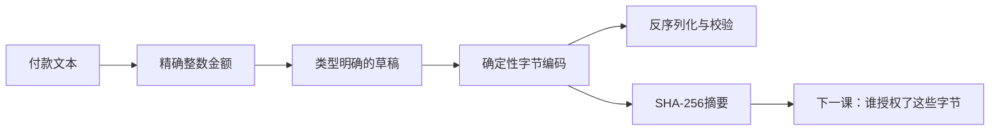

# 第01课｜让所有节点读懂同一笔付款

[课堂展示](课堂展示.html)

[课程大纲](../课程展示/课程大纲.md) · [知识点梳理](../课程展示/知识点梳理.md) · [下一课](../02-密钥、哈希与数字签名/讲义.md)

| 项目 | 内容 |
|---|---|
| 本课问题 | Alice 输入 0.00060000 BTC，不同机器如何得到同一金额、同一字节和同一摘要？ |
| **学习重点** | **概念：**整数聪与浮点误差；位、字节与十六进制；大端序与小端序；确定性序列化与反序列化；内存布局与线格式的区别；哈希摘要及其保证边界。<br>**算法：**十进制金额字符串精确转整数聪（逐位解析、补零、溢出检查）；小端整数编码与解码（移位、掩码）；有边界检查的顺序解析；十六进制编解码；SHA-256 的分块、填充与压缩流程，以及单次／双 SHA-256 调用。<br>**Bitcoin对应：**`CAmount`与`ParseMoney`；`CMutableTransaction`、`CTxOut`；CompactSize与交易序列化；`SpanReader`；`CSHA256`、`CHash256`；明确教学草稿与真实交易的区别。<br>**数据结构：**`Amount`（64位整数金额）；`PaymentDraft`（付款草稿结构体）；`Bytes`（动态字节数组）；`Hash256`（32字节定长数组）；`Reader`（只读字节引用＋游标）。<br>**掌握程度：**能实现并解释金额解析、编码与解码；能画出13字节字段布局，分析运算与存储开销；能说明SHA-256基本流程、正确调用库并验证摘要，不要求手写64轮哈希实现。 |
| 输入 | 收款标识 `2`、金额字符串 `0.00060000` |
| 输出 | `60000` 聪、13字节付款草稿、32字节摘要 |
| 前置 | C++变量、函数、循环、数组、基本整数运算 |
| 系统位置 | 钱包金额输入 → 共用字节编码 → 后续签名、交易标识与持久化基础 |
| 建议课时 | 基础知识75分钟＋实验45分钟；独立练习60分钟 |



## 第一部分：基础知识

本课对照 **Bitcoin Core v29.0**。下文区分两类内容：交易字段和哈希输入等协议规则，以及解析器、容器和优化等实现选择。具体字段解析会在第5/6课继续展开，本课先把基础接口与实际Bitcoin的位置对应起来。

| 本课知识 | Bitcoin 的具体对应 | 教学代码的当前范围 |
|---|---|---|
| 整数金额 | `CAmount`、`COIN`、`MoneyRange`；`ParseMoney`文本解析 | `Amount`与严格语法的`parse_amount` |
| 交易数据结构 | `CMutableTransaction`、`CTransaction`、`CTxIn`、`CTxOut` | 只有收款标识与金额的`PaymentDraft` |
| 字节序与序列化 | 小端固定宽度整数、CompactSize、`SerializeTransaction` | 13字节自定义格式；没有完整交易字段 |
| 有界解析 | `SpanReader`、`ReadCompactSize`、`UnserializeTransaction` | 固定长度与版本检查的`Reader`、`decode` |
| 哈希 | `CSHA256`、`CHash256`、`CHash160`及各自指定输入 | OpenSSL摘要调用；展示单哈希与双哈希 |


### 1. 整数金额与十进制字符串解析算法

**要解决的问题：**如何把用户输入的BTC小数精确转换为整数聪，并拒绝超精度、非法格式和越界金额？

Alice 的输入是十进制文本，计算机内部不能直接把界面字符串当金额运算。`0.1 + 0.2` 的二进制浮点结果可能不等于精确的 `0.3`；更重要的是，先读浮点再乘 `100000000` 会把舍入行为带进协议。

选择 **`int64_t` 表示整数聪**，把小数位留在输入和展示层。整数聪适合求和、比较、手续费和找零；十进制定点类型也能工作，但必须固定精度与编码；本课采用更容易跨语言对齐的整数接口。

设整数部分为 `w`，小数部分的数字整数为 `f`，小数位数为 `d`：

\[
A=w\times10^8+f\times10^{8-d},\quad 0\le d\le8.
\]

`0.00060000 → w=0,f=60000,d=8 → A=60000`；`0.0006` 的结果相同。输入形式可以不同，语义相同的金额必须编码为相同整数。

教学参数：`COIN=100000000`，`MAX_MONEY=21000000×COIN`。这里是范围上限，不表示本课已经实现发行规则。64位有符号整数能容纳这一上限，累加多笔金额仍必须逐步检查。

**解析步骤：**

1. 限制输入长度；要求至少一个整数数字。
2. 扫描每个字符，只接受数字和至多一个小数点。
3. 整数部分做 `w=10w+d` 前检查 `w≤floor((limit-d)/10)`，避免先溢出再判断。
4. 小数部分最多8位，不四舍五入；不足8位补零。
5. 合并后检查 `0≤A≤MAX_MONEY`。

本课输入语法拒绝负号、正号、空白、科学计数法、`.1`、`1.` 和超过8位的小数；接受前导零。若未来界面允许更多格式，应先规范化，再进入同一个金额接口。

**为什么能保证精确：**每次操作都是范围内的整数加乘，不经过浮点舍入；位数检查保证每一聪有唯一整数表示。后续多金额求和使用 `total≤MAX_MONEY-next` 再相加，不能只依赖 `int64_t` 足够大。

**开销：**对L个字符扫描一次，时间 `O(L)`、辅助空间 `O(1)`；代码另设32字符上限，限制解析资源。一个 `Amount` 占8字节。

真实代码对照：Bitcoin Core v29.0 的 [`consensus/amount.h`](https://github.com/bitcoin/bitcoin/blob/v29.0/src/consensus/amount.h)，阅读 `CAmount`、`COIN`、`MAX_MONEY`、`MoneyRange`。本课学习的是整数类型与边界检查的职责，而不是把其全部金额输入接口复制过来。

**Bitcoin 中的具体算法与调用层次：**

- `CAmount`是以聪为单位的64位有符号整数；`MoneyRange`负责金额范围判定，类型本身并不阻止负数或越界值。
- Core的金额文本工具 [`util/moneystr.cpp`](https://github.com/bitcoin/bitcoin/blob/v29.0/src/util/moneystr.cpp) 中，`ParseMoney`先处理输入字符串，再将整数部分与按十进制位权累加的小数部分合并，最后调用`MoneyRange`；`FormatMoney`执行整数聪到展示文本的反向转换。这是十进制定点解析，不是先转`double`再乘。
- 阅读顺序：`ParseMoney` → `COIN` → `MoneyRange` → `FormatMoney`。这是一条具体工具路径，不表示Bitcoin Core所有GUI/RPC入口都调用同一个解析函数。

**与教学代码的区别：**我们的解析器拒绝首尾空白，而此版本`ParseMoney`会先`TrimString`；教学接口失败抛异常，Core工具返回`std::optional<CAmount>`；两者的字符串语法不能视为完全相同。文本格式规则也不是链上共识规则——交易中存的是整数金额，不是BTC小数字符串。我们将解析与范围检查放在一个小函数内，尚未实现各输入接口及完整交易金额验证。

**下一步：**金额相同还不够。两台机器如何表示同一个付款对象？

### 2. 付款草稿与字节容器：PaymentDraft、Bytes、Hash256

**要解决的问题：**金额、收款方、编码字节和摘要分别应该用什么类型存放，程序内存布局与传输格式有什么区别？

当前只表达付款意图，尚无旧输出引用、找零和授权：

```cpp
using Amount = std::int64_t;
using Bytes = std::vector<unsigned char>;
using Hash256 = std::array<unsigned char, 32>;
struct PaymentDraft {
    std::uint32_t recipient; // 暂用整数标识，非 Bitcoin 地址
    Amount amount;
};
```

`PaymentDraft{2,60000}` 是程序内部对象。金额字段与收款字段的类型明确，使调用者无法把金额误当字符缓冲区。`Hash256` 用定长数组表达长度约束；`Bytes` 用动态数组承载不定长字节。

| 结构 | 存储与操作 | 本课选择的理由 |
|---|---|---|
| `Amount` | 8字节；比较/范围内加减为固定宽度操作 | 精确计算 |
| `Hash256` | 32字节内联存储 | 摘要长度固定 |
| `Bytes` | 对象元数据＋堆上容量；连续存储 | 编码追加、交给哈希库 |
| `PaymentDraft` | 字段总计12字节，ABI可能插入填充；本机实测16字节 | 语义对象，不作为网络格式 |
| `Reader` | 字节数组引用＋读取位置；不复制输入 | 边界检查与顺序解析 |

`vector` 单次扩容可能 `O(n)`，逐次追加摊还 `O(1)`；知道大小时 `reserve(13)` 避免中间扩容。常见64位实现的vector对象含若干机器字，但不能把具体大小写入协议。

**Bitcoin 中的具体数据结构：**

| 结构 | 用途与主要字段 | 与本课的对应 |
|---|---|---|
| `COutPoint` | 交易标识＋输出序号，引用旧输出 | 草稿尚无“钱从哪里来” |
| `CTxIn` | `prevout`、`scriptSig`、`nSequence`、`scriptWitness` | 草稿尚无输入及授权材料 |
| `CTxOut` | `nValue`、`scriptPubKey` | 金额对应`amount`；真实收款条件是脚本，不是整数`recipient` |
| `CMutableTransaction` | `version`、`vin`、`vout`、`nLockTime` | 构建和修改交易时使用 |
| `CTransaction` | 交易字段与缓存的标识 | 对象生命周期与哈希缓存，不是裸字节结构体 |

源码入口：[`primitives/transaction.h`](https://github.com/bitcoin/bitcoin/blob/v29.0/src/primitives/transaction.h)。本课的`PaymentDraft`没有一对一的Core交易类型对应；它是用来学习表示和编码的付款意图。

哈希载荷可对照 [`uint256.h`](https://github.com/bitcoin/bitcoin/blob/v29.0/src/uint256.h) 的`base_blob<256>`、`uint256`：它表达256位不透明数据，不应因为名字有uint就当作普通算术整数。Core另外区分`Txid`与`Wtxid`；教学`Hash256`只是32字节数组，尚未建立这些用途类型。

**存储区别：**真实交易包含输入/输出动态数组、脚本、见证和缓存，大小随内容变化。其`sizeof`只覆盖对象自身，不等于堆上数据总量，更不等于网络序列化长度；教学草稿的16字节内存大小、13字节编码均不能外推到真实交易。

**下一步：**直接发送结构体内存会带上填充字节和机器字节序，因此需要另定线格式。

### 3. 确定性序列化与小端整数编码算法

**要解决的问题：**如何让不同机器把同一份付款草稿编码成完全相同的字节，并避免字段顺序、填充和字节序造成歧义？

1字节是8位；1个十六进制字符表示4位；1字节用2个十六进制字符展示。十六进制是展示形式，不是另一种数值。

整数60000是 `0xEA60`。小端序先写低位字节：`60 ea`；大端序则为 `ea 60`。两种都能工作，关键是协议必须统一，不能依赖主机内存顺序。

本课固定 **教学付款草稿 v1**：

| 偏移 | 字段 | 类型/长度 | 编码 |
|---|---|---|---|
| 0 | version | 1字节 | 固定 `01` |
| 1–4 | recipient | uint32，4字节 | 小端 |
| 5–12 | amount | 非负金额，8字节 | 小端，解码后检查金额范围 |

总长度 `1+4+8=13` 字节，示例为：

```text
01 | 02 00 00 00 | 60 ea 00 00 00 00 00 00
010200000060ea000000000000
```

小端编码与解码：

\[
b_i=(v\gg8i)\mathbin{\&}255,\qquad
v=\sum_{i=0}^{w-1}b_i2^{8i}.
\]

编码使用无符号移位避免符号扩展；解码先累加为 `uint64_t`，做范围检查，再转换为 `Amount`。不能先把任意64位输入转成有符号金额再期望它安全。

**确定性要求：**固定字段顺序、固定宽度、固定版本、固定字节序、固定有效范围。对于合法规范字节，要求 `encode(decode(bytes)) == bytes`。

JSON可读性好，但空白、字段顺序和数字格式必须额外规范化；字符串直接拼接存在 `("ab","c")` 与 `("a","bc")` 歧义。未来变长字段采用长度前缀或显式计数，本课先用固定宽度。CompactSize 留到第5课。

真实代码对照：[`serialize.h`](https://github.com/bitcoin/bitcoin/blob/v29.0/src/serialize.h) 中的 `ser_writedata32`、`ser_readdata32`、`WriteCompactSize`。观察“逐字段编码”和“长度编码”分属不同规则。我们的13字节格式不是 Bitcoin 交易格式。

**Bitcoin 实际使用的编码规则：**整数采用字段规定的宽度与字节序；交易的输入/输出数量、脚本长度等使用 **CompactSize**。CompactSize的分段编码为：

| 数值x | 编码 |
|---|---|
| `0≤x<253` | 单字节x |
| `253≤x≤65535` | `fd`＋2字节小端x |
| `65536≤x≤2^32−1` | `fe`＋4字节小端x |
| 更大的uint64值 | `ff`＋8字节小端x |

实际可接受的长度还受解析上限及对象规则限制，不是能编码就允许分配。例：252编码为`fc`，253编码为`fd fd 00`。这与Core中另有的`VARINT`编码不是同一种格式。对应入口为`WriteCompactSize`、`ReadCompactSize`及固定宽度的`ser_writedata32/64`、`ser_readdata32/64`，均在 [`serialize.h`](https://github.com/bitcoin/bitcoin/blob/v29.0/src/serialize.h)。

**交易编码路径：**`CMutableTransaction`或`CTransaction` → `SerializeTransaction` → 按序写version、输入列表、输出列表、nLockTime；包含见证时按规则加入marker/flag及见证数据。没有“把C++对象内存原样复制到网络”这一步。具体字段布局见 [`transaction.h`](https://github.com/bitcoin/bitcoin/blob/v29.0/src/primitives/transaction.h)，第5/6课逐字段拆解。

**与教学代码的区别：**教学version是1字节，真实交易version是4字节；教学recipient是4字节占位标识，真实交易输出携带变长`scriptPubKey`；教学只允许一个金额字段，没有输入数组、输出数组、时间锁或见证。相同的是“显式逐字段编码”的方法，不是相同的协议格式。金额60000的8字节小端表示可以对应真实输出金额，但整份13字节草稿不兼容Bitcoin交易。

### 4. Reader 游标与有边界检查的反序列化算法

**要解决的问题：**如何按字段还原付款草稿，同时拒绝截断、额外字节、未知版本和超范围金额？

`Reader` 保存 `bytes` 引用与 `pos`。每次读取前检查剩余长度，读取成功才推进游标。当前游标由读接口维护，始终满足 `0≤pos≤size`。

`decode` 按顺序检查：总长13字节 → version为1 → recipient → amount → 金额范围。多1字节也拒绝，避免一份输入有多个解释。异常由调用者处理；函数成功前没有修改账本状态。

**正确性目标：**解析成功意味着“格式符合草稿协议”，不意味着Alice有钱、收款人存在或付款已授权。这些是后续语义验证。

**开销：**一般长度为n的消息，编码/解码时间 `O(n)`；返回编码需要 `O(n)`空间；只读游标解析固定字段额外空间 `O(1)`。当前n=13，所以实际是固定小开销。

**Bitcoin 中的具体读取与校验机制：**

1. [`streams.h`](https://github.com/bitcoin/bitcoin/blob/v29.0/src/streams.h) 的`SpanReader`从已有字节跨度读取；读取前检查剩余数据，成功后缩短剩余跨度。它与本课“引用＋游标”的目标相同，但状态表示和通用流接口不同。
2. `ReadCompactSize`除读取数值外，还检查最短规范编码及默认大小限制。例如表示1应使用`01`，不能用更长的`fd 01 00`。教学固定字段暂时没有这类变长长度检查。
3. `UnserializeTransaction`依据交易格式还原字段，并检查可选见证标记等结构约束。对象解析、金额/脚本语义、UTXO上下文、签名验证分属不同步骤；不能把某个读取函数当作完整交易验证器。

**与教学代码的区别：**我们在`decode`中规定总长必须等于13、version必须等于1；Core的底层流还可以连续读取多个对象，是否要求消息被完整消费由具体调用层决定。不能把教学的“剩余1字节就拒绝”或“只接受版本1”直接写成Bitcoin所有读取场景的统一规则。当前实验只覆盖草稿解析，完整交易验证在后续课程建立。

### 5. SHA-256 哈希算法与固定长度摘要

**要解决的问题：**如何为确定的消息字节计算可比较、可索引的摘要，以及摘要为什么不能证明付款者身份？

完整字节方便还原对象，摘要方便比较和作为索引键。SHA-256 接收任意长度消息，输出256位，即32字节。

哈希是确定函数：同一输入得到同一输出；修改字节通常改变输出。有限输出必然存在碰撞，因此“永不碰撞”不是保证；我们依赖可行计算预算下的抗碰撞与抗原像性质。攻击者可以重算被篡改消息的哈希，所以 **哈希本身不能证明作者**。

**SHA-256 的内部流程（认识流程，不要求手写64轮实现）：**

- 在消息后追加1位、零填充与64位原始位长度，使总长是512位的倍数。
- 每块64字节，先形成16个32位大端字，再扩展为64个字。
- 8个32位工作寄存器进行64轮混合，再累加进状态。
- 最终状态按规定顺序输出32字节。SHA内部大端读字与草稿整数的小端编码是两个不同层次。

\[
W_t=\sigma_1(W_{t-2})+W_{t-7}+\sigma_0(W_{t-15})+W_{t-16}\pmod{2^{32}}
\]
\[
T_1=h+\Sigma_1(e)+Ch(e,f,g)+K_t+W_t,\quad
T_2=\Sigma_0(a)+Maj(a,b,c).
\]

这里 `Ch(x,y,z)=(x∧y)⊕(¬x∧z)`，`Maj(x,y,z)=(x∧y)⊕(x∧z)⊕(y∧z)`；`Σ0`采用右旋2/13/22位，`Σ1`采用右旋6/11/25位，`σ0`采用右旋7/18位与右移3位，`σ1`采用右旋17/19位与右移10位；各组结果异或。`K_t`是标准轮常量；每轮更新 `a=T1+T2,e=d+T1`，其余寄存器顺次移位，所有加法取模 `2^32`。可选一轮观察一次输入位变化如何传播。规范依据：[FIPS 180-4](https://csrc.nist.gov/pubs/fips/180-4/upd1/final)。

对n字节消息，块数为 `ceil((n+9)/64)`，工作量随块数线性增长；流式算法的工作状态为常量空间。本例13字节需要1个块。若调用 `SHA256(SHA256(bytes))`，第二次输入固定32字节，再处理1块。双哈希不把256位输出扩成512位，也不使安全强度简单翻倍。

代码中保留 `sha256` 与 `double_sha256` 两个明确接口。第2课的签名接口内部做一次SHA-256，不能无意叠加。Bitcoin对照阅读 [`hash.h`](https://github.com/bitcoin/bitcoin/blob/v29.0/src/hash.h) 的 `CHash256`、`CHash160`，区分不同组合的输出和用途。

**Bitcoin 不是所有地方都“做一次SHA-256”：**

| 用途 | 具体算法与输入 | 实现入口 |
|---|---|---|
| SHA-256基础函数 | SHA-256(message) | `CSHA256::Write/Finalize/Reset`，[`crypto/sha256.h`](https://github.com/bitcoin/bitcoin/blob/v29.0/src/crypto/sha256.h) |
| 交易标识txid | 不含见证的交易序列化，做双SHA-256 | `CTransaction::ComputeHash` → `HashWriter`，[`transaction.cpp`](https://github.com/bitcoin/bitcoin/blob/v29.0/src/primitives/transaction.cpp) |
| 见证交易标识wtxid | 含见证的交易序列化，做双SHA-256；无见证时与txid相同 | `ComputeWitnessHash`，同上 |
| 区块头哈希/PoW | 80字节区块头，做双SHA-256 | `CBlockHeader::GetHash`、`HashWriter`，第12课展开 |
| HASH160标识 | RIPEMD-160(SHA-256(data))；P2WPKH场景输入为公钥编码 | `CHash160`，第2/5课展开 |
| Taproot相关带标签哈希 | `SHA256(SHA256(tag) || SHA256(tag) || message)` | 指定tag区分用途，不能用普通双SHA-256替代 |

组合实现入口为 [`hash.h`](https://github.com/bitcoin/bitcoin/blob/v29.0/src/hash.h) 中的`CHash256`、`CHash160`、`HashWriter`、`TaggedHash`。Taproot用途参考 [BIP341](https://bips.dev/341/)。同一底层哈希可组合成不同协议算法，调用时必须先确定用途和消息字节范围。

**与教学代码的区别：**`foundations.hpp`使用OpenSSL `EVP_Digest`计算SHA-256，Core此处使用自己的`CSHA256`及组合封装；基础SHA-256输出应一致，但库接口与优化不同。本课`sha256(draft_bytes)`和`double_sha256(draft_bytes)`都只是草稿摘要，**都不是Bitcoin txid**，因为输入不是完整Bitcoin交易。第2课教学签名接口内部单次SHA-256，也不能据此推断Bitcoin交易签名摘要采用相同流程。

**显示顺序也要核对：**本课`hex`按原始摘要字节顺序显示；Core的`uint256`常见十六进制显示顺序与其内部字节存储顺序相反。对照区块浏览器的txid前，先确认比较的是原始字节还是显示字符串；不要为了对齐字符串而改动SHA-256算法。相关实现阅读 [`uint256.cpp`](https://github.com/bitcoin/bitcoin/blob/v29.0/src/uint256.cpp) 的`base_blob::GetHex`。

## 第二部分：实验尝试

### 1. 准备与运行

需要 C++17 编译器、pkg-config、OpenSSL 3开发文件。macOS可用 `brew install openssl@3 pkg-config`；Debian/Ubuntu可用系统包 `g++ pkg-config libssl-dev`，并确认OpenSSL版本至少3.0。已具备依赖时不必安装。

在本课程目录运行：

```sh
bash ../../code/lesson-01/run.sh
```

脚本优先发现本机Homebrew OpenSSL 3，否则使用pkg-config配置；其他位置可设置 `PKG_CONFIG_PATH`。结果写入 `from-zero-to-BTC/code/build/lesson-01/`。脚本直接编译，不要求CMake。

### 2. 按付款流程写代码

参考实现：[foundations.hpp](../../code/lesson-01/foundations.hpp)；验证程序：[lab01.cpp](../../code/lesson-01/lab01.cpp)。先按下面接口独立实现或逐函数讲解，再运行参考验证；不以“运行完示例”替代学生编写。

| 步骤 | 写什么 | 输入 → 结果 | 需要解释 |
|---|---|---|---|
| A | `parse_amount` | `0.00060000` → `60000` | 为什么不用浮点；哪里先检查再乘 |
| B | `put_le`、`Reader::le` | 整数 ↔ 固定宽度字节 | 移位、掩码、读取边界 |
| C | `encode`、`decode` | 草稿 ↔ 13字节 | 为什么version、顺序和长度必须固定 |
| D | `hex`、`unhex` | 二进制 ↔ 展示文本 | 26个十六进制字符代表13字节 |
| E | `sha256`、`double_sha256` | 字节 → 32字节摘要 | 哈希层与对象编码层的边界 |

### 3. 先预测，再运行

依次比较 `0.00060000` 与 `0.0006`；比较60000与60001；比较recipient=2与recipient=3；比较对象内存大小与线格式长度。

本机参考结果：

```text
amount_sat=60000
wire_bytes=13
wire_hex=010200000060ea000000000000
sha256=54c84baf5560274cd84dcea2ba3d90eb9db9195f84961656adbe12affcdb2a7d
double_sha256=cabe344ece1c989c86725f3799eebbd11746f15a7b6ea59ac5968df1fa98c873
sizeof_PaymentDraft=16
```

前五项由输入和协议固定；`sizeof`依赖ABI。不能因为本机是16就给网络格式增加3个填充字节。

### 4. 主动让它失败

| 试验 | 预期 | 检验的规则 |
|---|---|---|
| `0.00000001` | 1聪 | 最小精度 |
| `21000000` | 接受 | 金额上界 |
| `21000000.00000001` | 拒绝 | 上界外一聪 |
| `-1`、`1e-8`、空串、超长整数 | 拒绝 | 输入语法与溢出保护 |
| 9位小数 | 拒绝，不舍入 | 精度契约 |
| 从末尾逐个截断所有长度 | 全部拒绝 | 读取边界 |
| 多加一个字节、修改版本 | 拒绝 | 唯一解释与版本 |
| 金额8字节全为ff | 拒绝 | unsigned到Amount转换前检查 |
| `SHA256("abc")` | 标准固定摘要 | 库调用正确性 |
| 改金额后重新计算哈希 | 新摘要不同 | 篡改可见，但仍没有身份认证 |

所有失败试验均在验证程序中执行；断言失败会导致非零退出。没有写入任何钱包或账本状态。

### 5. 运算与存储观察

固定例子的编码为13字节，十六进制展示为26字符，摘要为32字节。**对这份很短的对象，摘要比原文更长**；它的价值是固定长度与后续统一索引，而非每次都压缩。对1KB、1MB等输入，可扩充实验测SHA吞吐量：先预热，循环多次，只计哈希阶段，分别记录输入字节数与总耗时；不要把一次进程启动时间当哈希时间。

独立练习：添加 `format_amount` 并验证往返；给编码增加一个版本2字段但保持版本1严格拒绝陌生格式；统计输入长度增长时的哈希时间。新增字段必须先画出新布局，不能直接改变v1。

### 6. 接入区块链系统

| 本课成果 | 后续调用方 | 保留与演进 |
|---|---|---|
| `Amount`、解析接口 | 第3课金额守恒、第8课CLI | 保留；未来增加安全求和辅助函数 |
| `Bytes`、`Hash256` | 交易、区块、网络、存储 | 保留 |
| 显式整数读写 | 第3课交易编码、第10课区块编码 | 复用原语，分别定义消息布局 |
| `sha256` | 第2课摘要观察、后续哈希用途 | 保留；每种协议固定哈希组合 |
| `PaymentDraft` | 第2课授权演示 | 付款意图；第3/4课新增UTXO交易与签名预映像，不把草稿当完整交易 |

**验收：**能说出每项基础接口对应的Bitcoin算法、类型及源码符号；能解释为何草稿摘要不是txid、解析成功不是交易有效；能手写13字节布局；解释输入规范化；让无效输入被拒绝；定位编码与哈希实现；解释为什么摘要不能证明Alice授权。

**留给第2课的问题：**攻击者知道编码规则，也能改金额并重算哈希。验证者凭什么相信这是Alice同意的付款？
