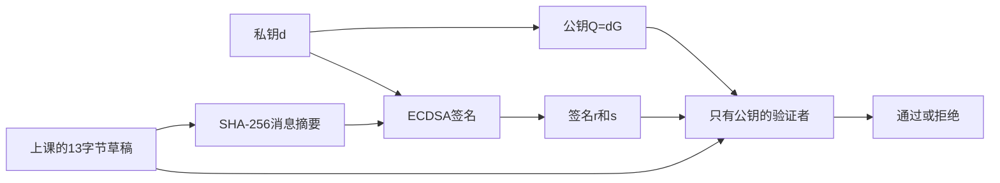

# 第02课｜证明这笔付款经过了谁的授权

[课堂展示](课堂展示.html)

[上一课](../01-字节、金额与确定性编码/讲义.md) · [课程大纲](../课程展示/课程大纲.md) · [知识点梳理](../课程展示/知识点梳理.md)

| 项目 | 内容 |
|---|---|
| 本课问题 | 任何人都能修改草稿并重算哈希；只有Alice能生成、其他人能核验的授权证据是什么？ |
| **学习重点** | **概念：**私钥、公钥与授权；签名与加密的区别；有限域、模运算与模逆；椭圆曲线点群、基点与群阶；**Bitcoin 的 secp256k1 曲线**；离散对数安全假设；签名随机数及重复使用风险；压缩公钥、公钥标识与签名编码。<br>**算法：**扩展欧几里得求模逆；曲线点加与倍点；二进制倍加法计算标量乘法；**secp256k1 上的 ECDSA 签名、验签**及正确性推导；**Taproot 的 BIP340 Schnorr 签名**（用途与边界）；重复随机数下的私钥恢复；压缩公钥编码；HASH160；基于成熟库的密钥生成、消息签名与公钥验签。<br>**数据结构：**私钥标量；曲线点与无穷远点；签名数对 `(r,s)`；`Key`（自动管理生命周期的密钥对象）；`Context`（签名／验签上下文）；33字节压缩公钥；20字节公钥标识；DER签名字节串。<br>**掌握程度：**能手算并实现小曲线的模逆、点加、倍加与ECDSA；能推导验签等式，区分模p与模n，解释随机数复用风险与运算、存储开销；能调用成熟库签署第1课的消息并验证篡改失败，不要求自行实现生产级大整数、secp256k1底层或常数时间密码学。 |
| 上一课输入 | `PaymentDraft{2,60000}` 的13字节确定性编码 |
| 本课输出 | secp256k1密钥、公钥、HASH160标识、签名与验签结果 |
| 前置 | 第1课；余数、整除、函数；模逆与曲线点运算在本课引入 |
| 系统位置 | 钱包签名 → 只有公钥的验证者；以后接入共用交易检查 |
| 建议课时 | 上半次90分钟：需求与数学推导；下半次90分钟：库调用、实验与系统接入 |

数学基础较好的学生可压缩成120分钟并将小曲线推演留作作业。两次课共享同一条付款流程，不拆成不相干的密码学名词课。



## 第一部分：基础知识

### 1. 数字签名与公钥认证

**要解决的问题：**任何人都能重算哈希，如何区分消息一致性与付款授权？

第1课得到固定字节。攻击者把60000改成60001，再计算新的SHA-256，完全可以得到格式正确的草稿和摘要。要解决的是“谁能为这些字节产生可验证的证据”。

共享密码或HMAC能认证，但每个持有验证秘密的节点也能伪造；公开哈希任何人都能算；数字签名把生成证据与验证证据分开：**私钥签名，公钥验签**。

签名不隐藏金额和收款方，也不凭空把某个公钥绑定到现实中的Alice。当前实验预先给验证者Alice公钥；第3/4课由旧输出的花费条件指明应使用哪把公钥。验证者若只接受提交者随附的任意公钥，攻击者可拿自己的密钥通过验证。

正确性目标：同一公钥、同一消息、有效签名能够通过；金额、收款方或公钥改变后，旧签名应失败。签名不证明余额充足、未双花、已入块或最终确认。

**先明确 Bitcoin 实际使用什么：**

| 层次 | Bitcoin 的具体选择 | 本课学到哪里 |
|---|---|---|
| 椭圆曲线参数 | **secp256k1**，方程 `y²=x³+7 mod p` | 明确p、G、n、私钥范围；不是任意曲线，也不是secp256r1/P-256 |
| 公钥生成运算 | **椭圆曲线标量乘法 `Q=dG`** | 用二进制倍加推导，用成熟库在真实曲线上执行 |
| 传统及SegWit v0签名检查 | **secp256k1 上的 ECDSA**，包括本课程P2WPKH路径 | 完整推导签名和验签；实验调用库 |
| Taproot签名检查 | **secp256k1 上的 BIP340 Schnorr** | 认识用途、基本等式和编码区别；完整实现放专题扩展 |
| Bitcoin Core实现库 | **libsecp256k1** | 定位公钥创建、ECDSA签名/验签、Schnorr签名/验签入口 |
| 当前教学实验 | **OpenSSL EVP 的 EC/secp256k1＋ECDSA** | 相同曲线和签名算法；不是Bitcoin Core的库适配或完整交易签名协议 |

**secp256k1 是曲线及参数集合的名称，ECDSA、Schnorr 是使用这条曲线的签名算法名称，标量乘法是它们依赖的底层运算。**不能只说“用椭圆曲线算法”，也不能认为采用同一曲线就采用同一种签名。

Bitcoin 的签名方案并非只有一种：传统及SegWit v0路径使用ECDSA，Taproot引入BIP340 Schnorr。依据：[BIP340](https://bips.dev/340/)、[BIP341](https://bips.dev/341/)。

### 2. secp256k1 公钥生成：有限域运算与标量乘法

**算法名称：**扩展欧几里得算法（求模逆）、椭圆曲线点加与倍点、二进制倍加算法（计算标量乘法）。

**要解决的问题：**如何从私钥高效生成可公开验证的公钥，同时使从公钥反推私钥在计算上不可行？

私钥为整数 `d∈[1,n−1]`，公钥为 `Q=dG`。`G`是约定基点，`n`是G的阶。正向标量乘法高效；从Q逆推出d依赖椭圆曲线离散对数问题，目前没有对适当曲线参数高效的通用经典算法。

先用有限域理解点运算。模p运算中，加减乘都取余；除法使用乘法逆元。`a⁻¹ mod p`满足 `a×a⁻¹≡1 mod p`，只有互素时才存在。扩展欧几里得算法由辗转相除同时求系数：`ax+py=gcd(a,p)`；gcd为1时x就是逆元。余数递推保证gcd不变，系数递推保证等式不变。

曲线方程：

\[
y^2\equiv x^3+ax+b\pmod p.
\]

这里小写a、b是曲线参数，与签名中的私钥d不同。加入无穷远点 `O` 后构成点群。`P+O=P`、`P+(-P)=O`；这两个分支必须在求逆之前处理。

对不同横坐标的点P、Q：

\[
\lambda=(y_Q-y_P)(x_Q-x_P)^{-1}\pmod p.
\]

倍点时：

\[
\lambda=(3x_P^2+a)(2y_P)^{-1}\pmod p.
\]

随后：

\[
x_R=\lambda^2-x_P-x_Q,\qquad
y_R=\lambda(x_P-x_R)-y_P\pmod p.
\]

若倍点时y=0，结果为O；不能尝试求0的逆元。点的“加法”是上述代数运算，不是坐标分别相加。

**标量乘法**可用二进制倍加实现：

```text
R = O, P = G
while k > 0:
    if k的最低位为1: R = R + P
    P = P + P
    k >>= 1
return R
```

经过每一轮，已经累计的部分与尚未处理的倍点部分仍表示原来的kG。对b位标量，最多b次倍点和b次条件相加，群运算次数为 `O(b)`。这与做k次相加的 `O(k)` 完全不同。

**落实到 Bitcoin 的 secp256k1 参数。**通用公式中的 `a=0,b=7`，曲线为：

\[
y^2\equiv x^3+7\pmod p,\qquad p=2^{256}-2^{32}-977.
\]

固定参数如下（十六进制）：

```text
p  = FFFFFFFFFFFFFFFFFFFFFFFFFFFFFFFFFFFFFFFFFFFFFFFFFFFFFFFEFFFFFC2F
Gx = 79BE667EF9DCBBAC55A06295CE870B07029BFCDB2DCE28D959F2815B16F81798
Gy = 483ADA7726A3C4655DA4FBFC0E1108A8FD17B448A68554199C47D08FFB10D4B8
n  = FFFFFFFFFFFFFFFFFFFFFFFFFFFFFFFEBAAEDCE6AF48A03BBFD25E8CD0364141
h  = 1
```

`G=(Gx,Gy)`为标准基点，n是G的阶，h为余因子。私钥取 `1≤d<n`，公钥计算 `Q=dG`。坐标计算模p，私钥、随机数和签名标量计算模n，**不能混用两个模数**。参数依据：[SEC 2 v2.0，第2.4.1节](https://www.secg.org/sec2-v2.pdf)。

实际流程为：安全随机数 → 有效私钥d → secp256k1标量乘法 → 公钥点Q → 公钥编码。比如仅作公开测试的 `d=1` 应得到G，压缩公钥应为 `02 || Gx`，可用于核对曲线选择和编码；它不是可用于保管资金的秘密。

二进制倍加是课堂展示标量乘法的具体算法，**不是声称Bitcoin Core底层逐步执行同一份教学循环**。Bitcoin要求计算出正确的Q，窗口、预计算、坐标表示等是实现优化；我们通过固定版本源码核对，不把优化策略误写成共识规则。


### 3. Bitcoin 的 ECDSA 数字签名：secp256k1 上的签名与验签

**要解决的问题：**如何让私钥持有者对指定消息生成授权证据，并让只持有公钥的人验证？

令消息字节为m，哈希转换后的整数为z；本课使用SHA-256及256位阶的曲线。签名随机数k每次必须安全生成，满足 `1≤k<n`。

**签名：**

\[
R=kG,\quad r=x_R\bmod n,\quad
s=k^{-1}(z+rd)\bmod n.
\]

若r或s为0，重新选择k。输出 `(r,s)`，不输出d或k。

**验签：**

\[
w=s^{-1}\bmod n,\quad u_1=zw\bmod n,\quad u_2=rw\bmod n,
\]
\[
X=u_1G+u_2Q.
\]

检查 `1≤r,s<n`，公钥编码及曲线有效性；若X为O则拒绝，否则检查 `x_X mod n = r`。验签只需要m、公钥Q和签名。

**为什么正确签名能通过：**代入 `Q=dG`：

\[
X=(z+rd)s^{-1}G=kG=R.
\]

这证明有效签名的代数一致性；不能单凭这个等式证明“绝对无法伪造”。防伪造还依赖密码学假设、正确参数、可靠随机数、实现与公钥归属绑定。曲线/签名规范参考：[SEC 1 v2.0](https://www.secg.org/sec1-v2.pdf)。

**落实到一笔 Bitcoin P2WPKH 交易：**

```text
要授权的输入、旧输出金额、scriptCode、输出与签名模式
    → BIP143 定义的签名预映像
    → SHA256(SHA256(预映像))，得到32字节摘要
    → secp256k1 上的 ECDSA 签名，得到(r,s)
    → DER编码＋签名模式字节
    → 与压缩公钥一起放入该输入的见证
```

验证者按同一签名模式重建摘要，检查公钥与旧输出条件的关系，再执行ECDSA验签。不是对界面金额字符串签名，也不是直接把txid当签名摘要。[BIP143](https://bips.dev/143/) 的完整字段在第6课展开。本课OpenSSL实验签的是教学草稿字节并内部做一次SHA-256；这与上述Bitcoin交易摘要不同，不能把当前实验结果直接广播到Bitcoin网络。

**Taproot 为什么还要点名 Schnorr：**Taproot使用同一条secp256k1曲线，但签名是BIP340 Schnorr。其核心关系可概括为 `s=k+ed mod n`，验证重建 `R=sG−eP`；挑战e使用BIP340规定的带标签哈希绑定R、公钥P和消息。完整算法还规定偶y规范化、nonce生成及范围检查，不能只凭这一条等式实现。BIP340公钥采用32字节x-only编码，签名本体64字节；Taproot花费中显式非默认签名模式可再附加1字节。Taproot输出公钥还涉及BIP341的tweak，不能直接把内部公钥当成输出公钥。依据：[BIP340](https://bips.dev/340/)、[BIP341](https://bips.dev/341/)。

本课完整掌握ECDSA；Schnorr在这里用于确定Bitcoin的真实算法范围，后续E2再展开，不用“Bitcoin只使用ECDSA”概括全部输出类型。

### 4. ECDSA 手算与重复随机数下的私钥恢复

**要解决的问题：**签名与验签的公式如何逐步算出结果，重复使用随机数为什么会泄露私钥？

课堂算例使用 `p=17,a=2,b=2,G=(5,1),n=19`，取 `d=7,z=13,k=3`。数字刻意很小，仅用于逐步演算。

| 步骤 | 运算 | 结果 |
|---|---|---|
| 倍点 | 2G | (6,3) |
| 再相加 | 3G=2G+G | (10,6) |
| 公钥 | 7G | Q=(0,6) |
| r | 10 mod19 | 10 |
| k的逆 | 3⁻¹ mod19 | 13 |
| s | 13×(13+10×7) mod19 | 15 |
| w | 15⁻¹ mod19 | 14 |
| u1、u2 | 13×14、10×14 mod19 | 11、7 |
| X | 11G+7Q=(11+49)G=3G | (10,6) |
| 比较 | X.x mod19 与 r | 10=10，通过 |

把z改成14，保留原签名，程序验签失败。要求学生先在纸上推到 `(r,s)=(10,15)`，再运行小曲线程序。参考实现是 [toy_curve.cpp](../../code/lesson-02/toy_curve.cpp)，复用工作区现有教学算例并在统一代码目录内保存，方便单独阅读。

**固定k为何危险：**若同一私钥对不同摘要z1、z2使用同一个k，得到相同r、不同s1/s2，则：

\[
k=(z_1-z_2)(s_1-s_2)^{-1}\bmod n,
\quad d=(s_1k-z_1)r^{-1}\bmod n.
\]

本例再签z2=14得到s2=9；攻击者从公开的 `(13,10,15)`、`(14,10,9)` 算出k=3、d=7。课堂固定k只有这一个推演用途。系统签名的k由成熟库管理，不能调用普通伪随机数生成器或沿用算例常量。

**Bitcoin Core具体怎样产生ECDSA的k：**v29.0的 `CKey::Sign` 调用libsecp256k1的 `secp256k1_nonce_function_rfc6979`，属于基于私钥与消息摘要的确定性nonce生成；为得到low-R编码，还可以带额外输入重试。安全要求是不能在不同消息间不安全地复用k，不是要求“每次必须重新抽一个独立随机数”。相同消息的确定性签名与上面的跨消息复用攻击并不矛盾。当前OpenSSL实验不承诺采用Bitcoin Core同一nonce生成路径。参考：[固定版本签名实现](https://github.com/bitcoin/bitcoin/blob/v29.0/src/key.cpp)。

### 5. 公钥与签名的数据结构：压缩编码、HASH160 与 DER

**要解决的问题：**数学上的曲线点和签名数对如何表示为明确的程序类型与可传输字节？

secp256k1私钥的标量表示为32字节；公钥坐标各32字节。未压缩公钥通常是 `04 || x || y`，共65字节；压缩公钥用 `02/03 || x`，共33字节，前缀记录y的奇偶性。解码需恢复y并验证点，不能仅凭33字节长度认定公钥有效。

`HASH160(pub)=RIPEMD160(SHA256(pub))`得到20字节公钥标识。必须明确哈希的是哪种公钥编码，同一曲线点用不同编码会得到不同标识。它不是公钥本身，也不是完整Bitcoin地址；地址编码在第5课。

签名数学上是两个标量；直接固定宽度可用64字节，但本课库输出DER结构，长度随整数的前导零处理变化，通常70–72字节，不固定为64字节。这里还没有Bitcoin的签名模式字节，也未实现其low-S策略或完整脚本规则；第6课处理标准兼容边界。

| 类型 | 当前实现 | 存储/生命周期 |
|---|---|---|
| `Key` | `unique_ptr<EVP_PKEY, deleter>` | 自动释放库对象；其内存占用大于32字节私钥载荷 |
| `Context` | `unique_ptr<EVP_MD_CTX, deleter>` | 每次签名/验签的上下文，避免手工遗漏释放 |
| `Bytes` | 复用第1课动态字节数组 | 公钥编码、签名字节、消息 |
| 公钥副本 | DER公钥导出后重新导入 | 不包含私钥；验证者只拿这一对象 |
| 公钥标识 | 20字节HASH160 | 以后可用于归属索引；不是直接代替所有锁定规则 |

真实代码导读：Bitcoin Core v29.0 [`key.cpp`](https://github.com/bitcoin/bitcoin/blob/v29.0/src/key.cpp) 的 `CKey::MakeNewKey`、`CKey::GetPubKey`、`CKey::Sign`，观察随机密钥生成与签名职责；[`pubkey.h`](https://github.com/bitcoin/bitcoin/blob/v29.0/src/pubkey.h) 的 `CPubKey`、`GetID`、`Verify`，观察公钥编码与验签接口。本实验以OpenSSL EVP作为可运行库适配器，Bitcoin Core对应路径使用libsecp256k1；两者不能当成逐行相同实现。

**具体代码入口对照：**

| 工作 | 当前教学代码 | Bitcoin Core v29.0 / libsecp256k1入口 |
|---|---|---|
| 选择曲线并生成密钥 | `generate_key`：`EVP_PKEY_Q_keygen(...,"EC","secp256k1")` | `CKey::MakeNewKey`生成有效私钥；`CKey::GetPubKey`调用 `secp256k1_ec_pubkey_create` |
| ECDSA签名 | `sign_message`：EC密钥＋`EVP_DigestSign` | `CKey::Sign` → `secp256k1_ecdsa_sign`，输入已构造好的摘要 |
| ECDSA验签 | `verify_message` → `EVP_DigestVerify` | `CPubKey::Verify` → `secp256k1_ecdsa_verify` |
| Schnorr签名 | 当前实验未实现 | `CKey::SignSchnorr` → `KeyPair::SignSchnorr` → `secp256k1_schnorrsig_sign32` |

定位参考：[`key.cpp`](https://github.com/bitcoin/bitcoin/blob/v29.0/src/key.cpp)、[`pubkey.cpp`](https://github.com/bitcoin/bitcoin/blob/v29.0/src/pubkey.cpp)。阅读时先找包装接口，再找库函数调用，最后核对输入是原文还是摘要，不能只停在函数名称。

### 6. ECDSA 复杂度与 EVP 签名接口

**要解决的问题：**签名与验签的开销来自哪里，调用库时如何避免重复哈希？

设消息长m字节、标量长b位、b位乘法成本为M(b)、模逆成本为I(b)。SHA-256时间随m线性；朴素仿射坐标倍加约需 `O(b)`次点运算，每次包含若干模乘及一次模逆，因此不能仅写一句“签名O(1)”掩盖代价。

| 操作 | 主要工作 | 空间/工程说明 |
|---|---|---|
| 密钥生成 | 安全随机标量＋dG | 曲线固定时输入规模固定，但不等于免费 |
| 签名 | 哈希m＋一次kG＋标量模逆/乘法 | 库上下文与随机数管理；不把预计算表算成零开销 |
| 验签 | 哈希m＋u1G与u2Q＋点加 | 实际库可做联合乘法，不能把“两次”当精确耗时比 |
| 小曲线倍加 | O(b)次群运算 | 少量点，朴素存储O(b)位；循环分支不适合作秘密相关生产实现 |
| 公钥标识 | SHA-256＋RIPEMD-160 | 固定33字节输入，20字节输出 |

成熟库可用投影坐标减少模逆、窗口法和预计算表提升速度；常数时间实现避免秘密相关分支/访存泄露。学生只需解释优化方向；小曲线代码用于看到公式，不能替代密码学库。

**最容易接错的接口：**本课 `sign_message(key, bytes)` 内部调用EVP并计算一次SHA-256。调用者应传第1课的13字节，不能先传 `sha256(bytes)`，否则签的是 `SHA256(SHA256(bytes))`。[`EVP_DigestSignInit`](https://docs.openssl.org/3.0/man3/EVP_DigestSignInit/) 将摘要算法与签名操作绑定；我们的函数名故意用message而非digest。

## 第二部分：实验尝试

### 1. 环境与文件

沿用第1课的C++17、pkg-config、OpenSSL 3。在本课目录执行：

```sh
bash ../../code/lesson-02/run.sh
```

脚本直接编译并验证三项：成熟库授权实验、小曲线算例、小曲线遍历测试。基础头文件通过include路径引用 `code/lesson-01`，不复制。实验不保存真实私钥、不输出私钥；生成的临时密钥在进程结束时释放。

| 文件 | 用途 |
|---|---|
| [crypto.hpp](../../code/lesson-02/crypto.hpp) | 密钥生成、公钥提取、压缩编码、HASH160、消息签名与验签 |
| [lab02.cpp](../../code/lesson-02/lab02.cpp) | 同一付款草稿的正常授权、主动篡改及粗略计时 |
| [toy_curve.cpp](../../code/lesson-02/toy_curve.cpp) | 模逆、点加、倍点、标量乘法和ECDSA推演 |
| [toy_curve_test.cpp](../../code/lesson-02/toy_curve_test.cpp) | 边界公钥/签名与小参数范围遍历验证 |

### 2. 依次增加授权能力

| 步骤 | 要写/理解的接口 | 观察结果 | 对应知识 |
|---|---|---|---|
| A | `inverse`、`add`、`multiply` | 7G=(0,6) | 有限域、点群、倍加 |
| B | 小曲线 `sign_digest`、`verify_digest` | (10,15)验签通过 | ECDSA等式 |
| C | `generate_key`、`public_only` | 验证者能拿到无私钥的公钥对象 | 私钥与公开验证分离 |
| D | `compressed_public`、`hash160` | 33字节公钥、20字节标识 | 类型与编码 |
| E | `sign_message`、`verify_message` | 原草稿通过，修改后失败 | 第1课编码被纳入授权 |
| F | 200次重复验签 | 平均耗时 | 消息哈希与曲线运算成本 |

学生先实现小参数算例中的模逆/倍加并解释验签等式，再调用成熟库完成真实曲线实验。系统签名模块的学习重点是边界、输入和错误处理，不要求独立实现大整数和secp256k1底层。

### 3. 正常路径

```text
recipient=2, amount=60000
          ↓ encode（复用第1课）
010200000060ea000000000000
          ↓ sign_message（内部SHA-256）
DER签名
          ↓ verify_message（只有公钥）
true
```

预期固定观察：`public_bytes=33`、`key_id_bytes=20`、`valid=true`。公钥、签名内容以及DER长度可能随运行变化；第二次签名只要求仍可验证，不要求签名字节必然相同或必然不同。小曲线结果固定为公钥 `(0,6)`、签名 `(10,15)`。

### 4. 四种“看起来差不多”的失败

| 操作 | 预期 | 为什么 |
|---|---|---|
| 保留签名，60000改60001 | false | 金额字节被签名覆盖 |
| 保留签名，收款标识2改3 | false | 收款字节被签名覆盖 |
| 换成其他公钥 | false | 授权与指定公钥绑定 |
| 改签名末字节 | false | 数学签名不再成立 |
| DER换成单字节00 | false | 非法编码不能成为有效签名 |
| 先算SHA-256再交给sign_message，验签仍传原文 | false | 双哈希和单哈希边界不一致 |
| 用同一私钥再次对原文签名 | true | 不以签名字节是否相同判断有效性 |

接口初始化或密钥生成失败抛出异常；验签结果为false表示输入签名不被接受。库内部错误诊断在正式节点中应另行记录，不能把错误当验签成功。

补充手算实验：用同一k对z=13、14签名，从两份公开签名恢复d=7。解释为何这不是破解ECDSA，而是违反随机数使用条件。

### 5. 性能与空间观察

实验对同一13字节消息循环200次验签，以单调时钟记录总微秒数，再除以200。计时区间包含每次上下文分配、初始化、消息哈希与椭圆曲线验证，不包含密钥生成、签名生成、编译或标准输出。它是这个封装接口的观测，不是libsecp256k1的基准，也不是网络吞吐量。

独立练习：分别测签名与验签；改变消息长度；多轮运行记录中位值；将上下文复用作为后续优化实验。不要用一次测量断言哪个密码学库更快。

按载荷估算：13字节草稿＋33字节压缩公钥＋约70–72字节DER签名，约116–118字节；尚不包含消息类型、长度前缀或容器开销。这不是Bitcoin交易的vsize。若验证方已知公钥，传输设计可以不同；第4课会根据花费条件决定验证材料。

### 6. 代码如何进入区块链

| 已得到的组件 | 下游位置 | 接入约定 |
|---|---|---|
| `generate_key` | 第7课密钥管理 | 从进程临时密钥演进为受控存储；不直接把私钥写日志 |
| `compressed_public`、`hash160` | 第5课脚本、第7课归属索引 | 固定编码再计算标识 |
| `sign_message` | 第4课授权、第8课付款构造 | 传明确定义的签名预映像字节 |
| `verify_message` | 第4课共用检查，第10/11课复用 | 公钥必须匹配旧输出条件，验签通过只是合法性的一个条件 |
| 第1课编码原语 | 全部消息/交易构造 | 复用原语；正式交易有自己的字段布局 |
| 小曲线程序 | 教学推演 | 不进入实际授权模块 |

当前签名只绑定付款草稿，不含输入引用、链标识和旧币金额，因此没有完整的交易重放保护。第3课建立UTXO与交易结构；第4课把输入位置、旧币资料、链标识和输出放进明确定义的授权预映像，复用本课签名模块。第6课另做BIP143标准实验，不能把教学字段混入Bitcoin摘要。

**验收：**能从 `(r,s)` 等式推导验签通过；区分模p与模n；说明k重复为何泄露私钥；指出验证者使用的是公钥副本；解释每种篡改结果；正确说明单次哈希接口边界与存储开销。

**留给第3课的问题：**Alice确实签了付款，但她拥有哪一笔钱？如果同时签两笔使用同一笔钱的付款，节点依据什么拒绝其中一笔？
